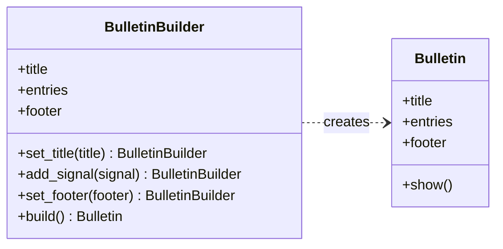
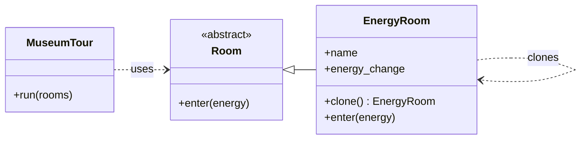
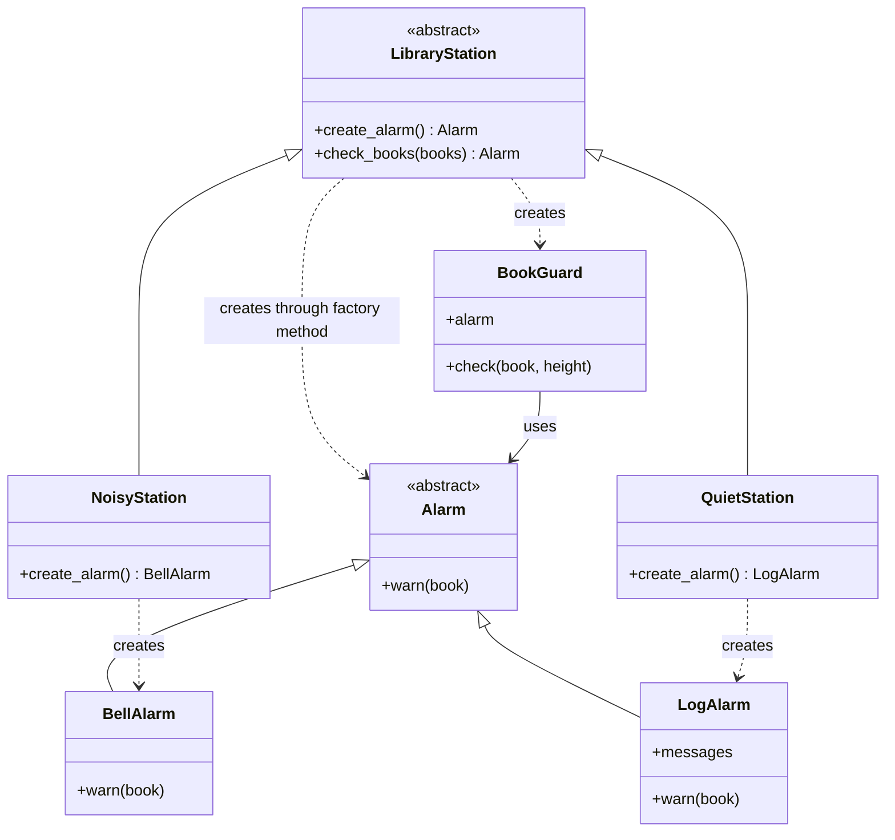

# Lab 2: Creational Design Patterns

This document explains the three creational patterns added to Lab 1: Builder, Prototype, and Factory Method. Each example reuses classes from the SOLID programs in this folder.

The UML class diagrams use Mermaid and render in the GitHub Markdown preview.

Run the examples from this folder:

```bash
cd ~/Desktop/uni/TMPS/lab2
python3 builder_signal_bulletin.py
python3 prototype_museum_rooms.py
python3 factory_method_library.py
```

Builder fits a bulletin assembled from several parts. Prototype creates museum rooms from a configured template. Factory Method lets library stations choose which alarm to create.

## 1. Builder

**File:** [`builder_signal_bulletin.py`](builder_signal_bulletin.py)

### Introduction

Builder creates an object step by step. It is useful when some parts are optional or are added one at a time.

### Implementation

- `BulletinBuilder` sets a title, adds signals, and sets a footer.
- `build()` creates a `Bulletin` with its own copy of the entries.
- The program uses `SignalParser` and `SignalArchive` from the SRP example.

### Description

The program receives two moon signals. It then builds and displays a bulletin titled "Moon Watch". The builder keeps the construction steps in one place while `Bulletin` represents the finished result.


### Pseudocode

```text
CLASS BulletinBuilder
    title = "Untitled bulletin"
    entries = empty list
    footer = "End of bulletin"

    METHOD set_title(value)
        title = value
        RETURN this builder

    METHOD add_signal(signal)
        moon, message = signal
        ADD formatted moon and message TO entries
        RETURN this builder

    METHOD set_footer(value)
        footer = value
        RETURN this builder

    METHOD build()
        RETURN new Bulletin(title, COPY of entries, footer)

parser = new SignalParser()
archive = new SignalArchive()
archive.add(parser.parse("Io: volcano awakened"))
archive.add(parser.parse("Europa: ocean discovered"))

builder = new BulletinBuilder()
builder.set_title("Moon Watch")
FOR EACH signal IN archive.signals
    builder.add_signal(signal)
builder.set_footer("Report complete")
bulletin = builder.build()
bulletin.show()
```

### UML Class Diagram



`BulletinBuilder` constructs the product step by step. `Bulletin` stores and displays the finished result. `build()` copies the entries so later builder changes do not change an existing bulletin.

## 2. Prototype

**File:** [`prototype_museum_rooms.py`](prototype_museum_rooms.py)

### Introduction

Prototype creates a new object by copying an existing object. The existing object serves as a template.

### Implementation

- `EnergyRoom` implements the `Room` interface from the OCP example.
- `clone()` returns a copy of an existing room.
- The program clones `Quiet Cave` to create `Mirror Cave` and `Healing Cave`, then gives all three rooms to `MuseumTour`.

### Description

Each cloned room starts with the template's settings and can then be changed independently. The tour runs every room through the same `enter()` method.


### Pseudocode

```text
CLASS EnergyRoom EXTENDS Room
    CONSTRUCTOR(name, energy_change)
        STORE name and energy_change

    METHOD clone()
        RETURN SHALLOW COPY of this room

    METHOD enter(energy)
        DISPLAY name and energy_change
        RETURN energy + energy_change

template = new EnergyRoom("Quiet Cave", -1)

mirror_cave = template.clone()
mirror_cave.name = "Mirror Cave"
mirror_cave.energy_change = -2

healing_cave = template.clone()
healing_cave.name = "Healing Cave"
healing_cave.energy_change = 3

tour = new MuseumTour()
tour.run([template, mirror_cave, healing_cave])
```

### UML Class Diagram



`EnergyRoom` is the concrete prototype: it can copy itself. `MuseumTour` uses rooms through the existing `Room` interface. Each clone is a separate object; the shallow copy is sufficient because its fields contain only a string and a number.

## 3. Factory Method

**File:** [`factory_method_library.py`](factory_method_library.py)

### Introduction

Factory Method lets subclasses choose which concrete object to create. The main workflow calls a creation method without naming the concrete class.

### Implementation

- `LibraryStation` defines `create_alarm()` and the shared `check_books()` workflow.
- `NoisyStation` creates a `BellAlarm`.
- `QuietStation` creates a `LogAlarm`.
- Both alarms and `BookGuard` come from the DIP example.

### Description

Both stations check the same books. One prints an alarm, while the other stores it in a log. The checking workflow stays in `LibraryStation`; each subclass chooses its alarm by overriding `create_alarm()`.

### Pseudocode

```text
CLASS LibraryStation
    METHOD create_alarm()
        RAISE "Subclass must implement this method"

    METHOD check_books(books)
        alarm = create_alarm()
        guard = new BookGuard(alarm)
        FOR EACH book, height IN books
            guard.check(book, height)
        RETURN alarm

CLASS NoisyStation EXTENDS LibraryStation
    METHOD create_alarm()
        RETURN new BellAlarm()

CLASS QuietStation EXTENDS LibraryStation
    METHOD create_alarm()
        RETURN new LogAlarm()

books = [("Atlas of Winds", 2), ("Dragon Handbook", 8)]

noisy_station = new NoisyStation()
noisy_station.check_books(books)

quiet_station = new QuietStation()
alarm = quiet_station.check_books(books)
DISPLAY alarm.messages
```

### UML Class Diagram



`LibraryStation` is the creator, and `create_alarm()` is its factory method. The two station subclasses are concrete creators. `Alarm` is the product interface; `BellAlarm` and `LogAlarm` are concrete products. The shared workflow creates a `BookGuard` with the selected alarm.
