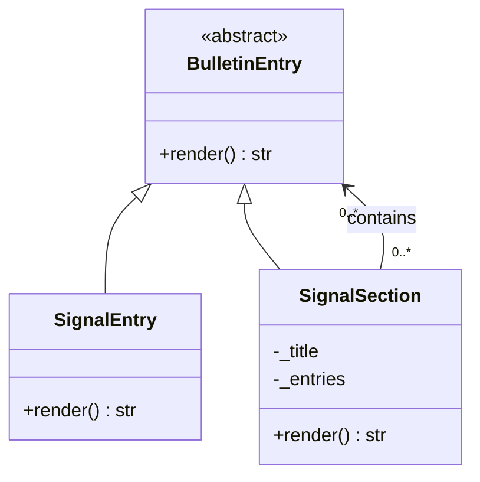
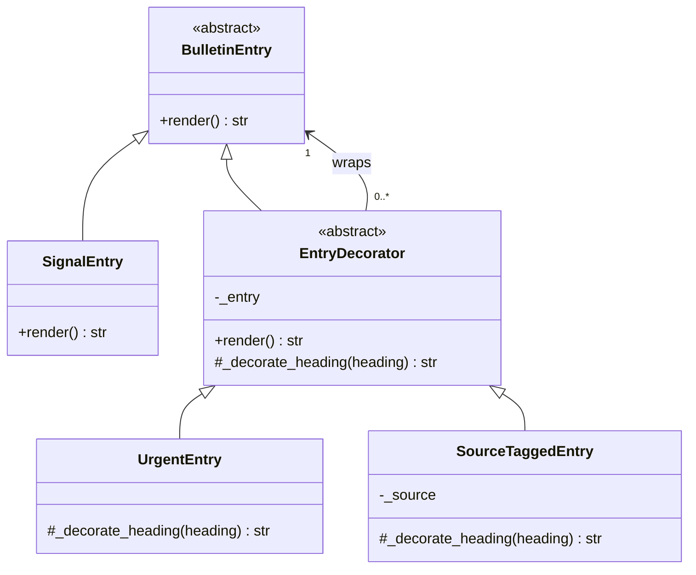
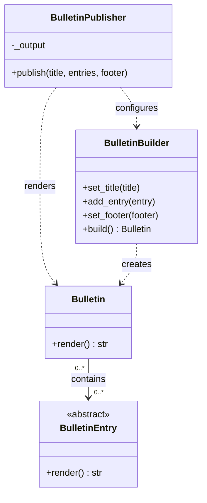

# Lab 3 — Structural Design Patterns

## Domain description

Moon Watch is a console app that publishes a bulletin of signals from Jupiter's moons. The demo puts an urgent, source-tagged signal from Io in an Alerts subsection and gives the Europa signal its own entry in the Jupiter system section. One call publishes the complete bulletin. [Demo source](app/__main__.py)

The publisher uses the Builder from Lab 2's bulletin example, adapted to store `BulletinEntry` objects. This lets it assemble a bulletin from plain signals, sections, and decorated entries through the same `add_entry()` method. [Lab 2 Builder](../lab2/builder_signal_bulletin.py) · [Lab 3 Builder](patterns/builder.py)

## 1. Composite

A bulletin can show an individual signal or a whole section. `BulletinEntry` is the Component, `SignalEntry` is the Leaf, and `SignalSection` is the Composite. A section holds entries through the common interface, so a child can itself be a section. [Component and leaf](domain/bulletin.py)



### Code excerpt

```python
class SignalSection(BulletinEntry):
    def __init__(self, title: str, entries: Iterable[BulletinEntry]):
        self._title = title
        self._entries = tuple(entries)

    def render(self) -> str:
        lines = [self._title]
        for entry in self._entries:
            lines.append(indent(entry.render(), "  "))
        return "\n".join(lines)
```

`SignalSection.render()` calls `render()` on every child. If a child is another section, that call renders its subtree and the parent indents the returned text. [Composite source](patterns/composite.py)

### Unit tests

| Test | What it checks |
| --- | --- |
| `test_signal_and_section_use_the_same_interface` | A single signal and a section both work as entries in the same bulletin. |
| `test_nested_sections_render_in_order` | A nested section renders its contents at the correct depth and preserves entry order. |

Both tests passed. [Test source](tests/test_bulletin.py#L13) · [Test run](#test-run)

## 2. Decorator

An editor can mark a signal urgent, attach its source, or apply both labels. `BulletinEntry` is the Component, `SignalEntry` is a Concrete Component, and `EntryDecorator` is the abstract Decorator. `UrgentEntry` and `SourceTaggedEntry` are the two Concrete Decorators. Each wrapper accepts a `BulletinEntry`, which includes other decorators and whole sections.



### Code excerpt

```python
class EntryDecorator(BulletinEntry):
    def __init__(self, entry: BulletinEntry):
        self._entry = entry

    def render(self) -> str:
        heading, newline, body = self._entry.render().partition("\n")
        return f"{self._decorate_heading(heading)}{newline}{body}"

    @abstractmethod
    def _decorate_heading(self, heading: str) -> str:
        raise NotImplementedError


class UrgentEntry(EntryDecorator):
    def _decorate_heading(self, heading: str) -> str:
        return f"[URGENT] {heading}"


class SourceTaggedEntry(EntryDecorator):
    def __init__(self, entry: BulletinEntry, source: str):
        super().__init__(entry)
        self._source = source

    def _decorate_heading(self, heading: str) -> str:
        return f"{heading} [source: {self._source}]"
```

The wrapper delegates rendering to its entry and changes only the first line of the result. Applying the urgency prefix and source suffix in either order produces the same heading. [Decorator source](patterns/decorator.py)

### Unit tests

| Test | What it checks |
| --- | --- |
| `test_decorators_stack_in_either_order` | Both wrapper orders produce the expected text, and the original signal still renders without labels. |
| `test_decorated_section_keeps_its_children` | A source label changes the section heading and preserves the child output. |

Both tests passed. [Test source](tests/test_bulletin.py#L34) · [Test run](#test-run)

## 3. Facade

`BulletinPublisher` is the Facade used by the console client. Its `publish()` method coordinates the `BulletinBuilder`, the finished `Bulletin`, and an output function. The demo uses the default `print` function. The tests pass a recording function through the same interface.



### Code excerpt

```python
class BulletinPublisher:
    def __init__(self, output: Callable[[str], None] = print):
        self._output = output

    def publish(self, title: str, entries: Iterable[BulletinEntry], footer: str) -> None:
        builder = BulletinBuilder().set_title(title)
        for entry in entries:
            builder.add_entry(entry)
        bulletin = builder.set_footer(footer).build()
        self._output(bulletin.render())
```

`publish()` creates a fresh Builder, assembles the bulletin, and sends the rendered result to the output in a single call. Rendering belongs to `Bulletin` and its entries. [Facade source](patterns/facade.py)

### Unit tests

| Test | What it checks |
| --- | --- |
| `test_publisher_renders_entries_before_sending_one_bulletin` | Recording entries and an output callback show that entries render in order before the complete bulletin is sent once. |
| `test_each_publication_has_its_own_entries` | Two publications through the same publisher each include their own entries. |

Both tests passed. [Test source](tests/test_bulletin.py#L50) · [Test run](#test-run)

## Test run

Run the suite from the repository root.

```bash
python3 -m unittest discover -s lab3/tests -v
```

```text
test_built_bulletin_is_independent_of_later_builder_changes (test_bulletin.BuilderTests.test_built_bulletin_is_independent_of_later_builder_changes) ... ok
test_nested_sections_render_in_order (test_bulletin.CompositeTests.test_nested_sections_render_in_order) ... ok
test_signal_and_section_use_the_same_interface (test_bulletin.CompositeTests.test_signal_and_section_use_the_same_interface) ... ok
test_decorated_section_keeps_its_children (test_bulletin.DecoratorTests.test_decorated_section_keeps_its_children) ... ok
test_decorators_stack_in_either_order (test_bulletin.DecoratorTests.test_decorators_stack_in_either_order) ... ok
test_demo_uses_all_three_structural_patterns_together (test_bulletin.DemoTests.test_demo_uses_all_three_structural_patterns_together) ... ok
test_each_publication_has_its_own_entries (test_bulletin.FacadeTests.test_each_publication_has_its_own_entries) ... ok
test_publisher_renders_entries_before_sending_one_bulletin (test_bulletin.FacadeTests.test_publisher_renders_entries_before_sending_one_bulletin) ... ok

----------------------------------------------------------------------
Ran 8 tests in 0.000s

OK
```

## Conclusions

The trickiest case was decorating a whole section. A source label belongs on the section heading, so the decorator changes the first line and preserves the child lines with their indentation. The common `render()` method then lets the publisher handle the decorated section through the same interface as a single signal.

If the app needed both console and HTML output, I would keep headings, labels, and children structured until the final rendering step. Each renderer could then format the same bulletin for its own output.
